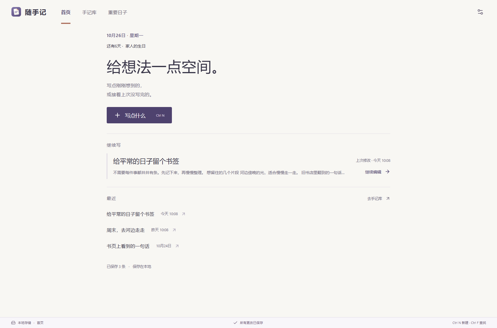
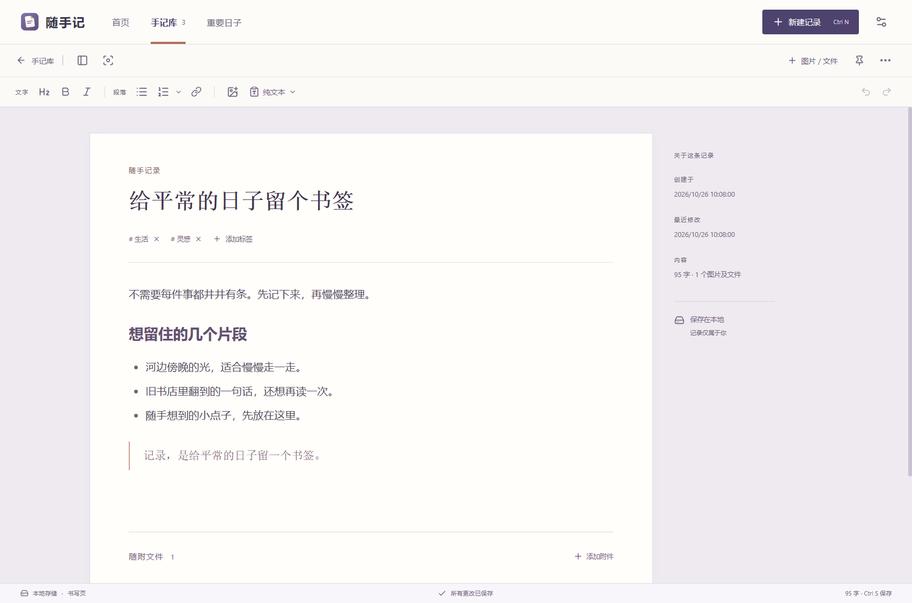
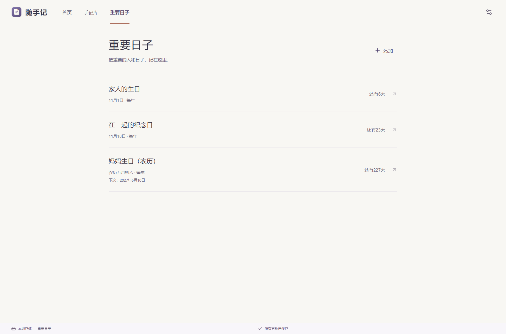

# 随手记

**记下此刻，也记住那些不想忘记的日子。**

一款安静、易用的 Windows 本地记录软件。把突然冒出的想法、截图和文件收在一起，也替你记着家人的生日和纪念日。

**[下载 Windows 版](https://github.com/zhuliuqingfeng-blip/suishouji/releases/latest)** · [使用说明](docs/使用说明.txt) · [反馈问题](https://github.com/zhuliuqingfeng-blip/suishouji/issues)

Windows 64 位 · 安装版 / 免安装版 · 离线可用 · 数据保存在本地

## 随手记下，随时找回

从一条新想法开始，接着上次写，或翻翻最近的记录。打开软件后，由你决定从哪里开始。

- **文字、图片、文件放在一起**：粘贴截图，拖入图片或附件。文件会保存独立副本，原文件移动或删除后仍能打开。
- **简单排版，写起来顺手**：支持标题、加粗、列表和链接，也能复制、粘贴为纯文本，留下内容，去掉多余格式。
- **想找的时候，找得到**：搜索标题、正文和附件名称，用标签整理片段，把常看的记录置顶。
- **写完不用惦记保存**：输入停顿时自动保存，切换和关闭前完成保存。误删的手记还能从回收站找回。

需要专心时，收起目录，进入专注模式，留一页安静的书写空间。

## 也记住重要的人和日子

伴侣的生日、家人的农历生日、在一起的纪念日，记下一次，临近时给自己一个提醒。

- 公历、农历都支持，农历闰月也能单独记录。
- 每年重复的日子自动寻找下一次日期，按远近排列。
- 可设置提前提醒；临近时，在首页和应用内给你轻提示。

提醒在软件运行时生效，关闭后不会在后台提醒。

*以上界面均来自实际软件，内容为虚构演示资料。*

## 资料保存在自己的电脑里

无需注册账号，断网也能记录。安装版将资料独立保存在当前用户的应用数据目录，更新时运行新版安装包即可继续使用，正常卸载也会保留资料。免安装版则把资料放在软件旁的“我的数据”里，方便随文件夹携带。

每天首次启动自动备份，保留最近七份；也可以一键备份全部资料，或将手记导出为 HTML，用浏览器阅读。换电脑时，在新电脑安装软件并恢复完整备份，就能把记录一起带走。

## 开始使用

1. 打开 **[最新版下载页](https://github.com/zhuliuqingfeng-blip/suishouji/releases/latest)**，在 **Assets** 选择文件。
2. **推荐安装版**：运行 `suishouji-版本号-setup-x64.exe`，可以自选程序位置。以后的更新直接运行新版安装包，默认沿用上次的位置。
3. **免安装版**：下载 Windows x64 的 `.zip`，完整解压后双击 `随手记.exe`。需要随文件夹携带资料时可选这一版。
4. 点击“写点什么”，记下第一件想留下的事。无需配置 Node.js 或数据库。

已经在用免安装版？首次打开安装版时选择“从免安装版导入”，关闭旧版后选中原软件文件夹即可，旧资料会保留。[迁移与使用说明](docs/使用说明.txt)。

安装版从 1.8.0 开始提供；更早版本的下载页只有免安装包。GitHub 自动生成的 **Source code** 是源码，不是可运行的软件。

更多文档与项目说明

- [开发说明](docs/开发说明.md)
- [验收记录](docs/验收记录.md)
- [问题反馈与使用建议](https://github.com/zhuliuqingfeng-blip/suishouji/issues)

本项目暂未指定开源许可证。第三方依赖仍适用各自许可证，农历库许可见 [第三方许可](app/assets/third-party/lunar-typescript-LICENSE.txt)。

